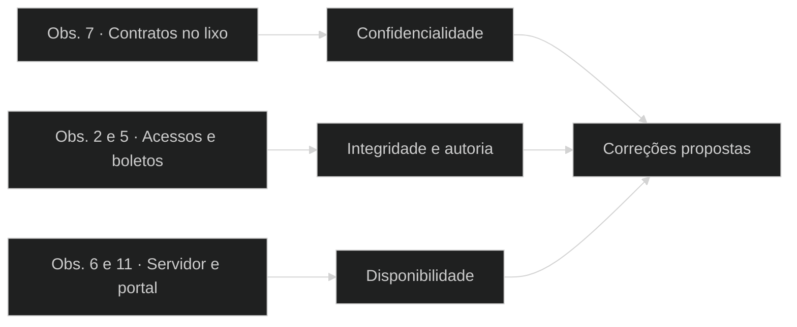

# Relatório de Auditoria e Conformidade em Segurança da Informação

## Imobiliária Porto da Barra

| Identificação | Informação |
| --- | --- |
| Auditor responsável | Uriel Vieira Carvalho |
| Cliente do cenário | Sra. Helena, proprietária |
| Professor | Alexmário Modesto de Jesus |
| Disciplina | Introdução à Segurança da Informação, turma 3004 |
| Emissão | Outubro de 2026 |
| Finalização documental | 24 de outubro de 2026 |
| Situação | Versão final revisada e aprovada pelo autor |

> **Natureza:** auditoria simulada baseada em materiais didáticos. Os fatos pertencem ao caso fictício; não houve visita real, teste de intrusão ou acesso a sistemas de terceiros. Este documento não atesta certificação ou conformidade integral.

## Sumário

1. [Resumo executivo](#resumo)
2. [Escopo e método](#escopo)
3. [Achados e correções](#achados)
4. [Senhas: resultados e criação segura](#senhas)
5. [Matriz qualitativa de riscos](#riscos)
6. [Governança, ISO e LGPD](#governanca)
7. [Plano de ação recomendado — proposta](#plano)
8. [Respostas da planilha](#respostas)
9. [Conclusão](#conclusao)
10. [Declaração ética e assinaturas](#assinaturas)

## 1. Resumo executivo

A Imobiliária Porto da Barra, no caso fictício, possui dez funcionários e administra cerca de quatrocentos imóveis alugados em Salvador. Guarda contratos, CPF, comprovantes de renda, dados bancários e boletos. O cenário relata uma alteração de valor de aluguel sem autoria identificada e o descarte de um contrato com dados pessoais na calçada.

O sistema principal está descrito como instalado em servidor da própria loja e acessível pela internet. As tarefas de governança também apresentam uma situação de fornecedor em nuvem; ela é analisada no contexto da questão, sem presumir migração ou arquitetura SaaS para toda a operação.

Os três problemas prioritários são o descarte de contratos com CPF e renda na calçada (obs. 7), que expõe a privacidade de inquilinos; os acessos compartilhados e a edição irrestrita de boletos (obs. 2 e 5), que prejudicam a atribuição de autoria e a integridade financeira; e o servidor sob a pia (obs. 6), que coloca a continuidade em risco por sua exposição à água. Recomenda-se, respectivamente, descarte seguro, contas individuais com permissões e registros adequados e transferência do servidor para local protegido. A indisponibilidade recorrente no dia 5 (obs. 11) exige avaliação adicional de capacidade.

**Decisão recomendada:** priorizar os controles básicos, organizar responsáveis e registros e confirmar a exigência comercial da construtora antes de assumir prazo ou investimento em certificação.

## 2. Escopo e método

Foram examinados o enunciado da prática, as onze abas da planilha, o código do verificador e o relatório anterior. As respostas completas constam em [Respostas da prática](docs/RESPOSTAS.md), com as perguntas e a numeração originais. Os materiais e as fontes oficiais estão identificados em [Referências](docs/REFERENCIAS.md).

| Natureza da informação | Tratamento neste relatório |
| --- | --- |
| Observações e incidentes do caso | Fatos fictícios fornecidos pelo exercício, não evidências de campo coletadas pelo autor |
| Resultados de senhas | Saídas reproduzidas da função original do HTML, com campos simulados localmente |
| Probabilidades, prioridades e prazos | Propostas qualitativas para discussão, sem medição de frequência ou orçamento |
| Controles e documentos futuros | Recomendações; não são ações executadas ou evidências já existentes |
| Ausências de informação | Explicitadas, sem substituir lacunas por supostos achados |

Não foram fornecidos logs reais, laudos de capacidade, inventário técnico completo, certificado do fornecedor ou evidências de execução de backups. A cópia em pen drive descrita na obs. 9 não permite concluir se existe ou não outra rotina de backup.

## 3. Achados e correções

| Obs. | Condição do cenário | Consequência principal | Correção proposta |
| --- | --- | --- | --- |
| 1 | Contratos com CPF e comprovante de renda dos inquilinos ficam empilhados no balcão da recepção, à vista de quem chega. | Confidencialidade | Guardar contratos em armário com acesso restrito. |
| 2 | Os cinco corretores usam o mesmo login, "corretor", com a mesma senha, para entrar no sistema de aluguéis. | Integridade | Adotar contas individuais, autenticação adequada e registros de operações. |
| 3 | Um corretor que saiu há três meses ainda acessa o sistema de aluguéis pelo celular. | Confidencialidade | Revogar a conta e as sessões do ex-funcionário imediatamente. |
| 4 | A estagiária do atendimento consegue ver e editar os dados bancários de todos os proprietários. | Integridade | Restringir consulta e edição bancária às funções que necessitam desses acessos. |
| 5 | Os boletos são gerados numa planilha que qualquer funcionário pode editar; um valor de aluguel foi alterado e ninguém sabe por quem. | Integridade | Restringir edição dos boletos e registrar alterações e aprovações individuais. |
| 6 | O servidor do sistema de aluguéis fica no chão, embaixo da pia da copa. | Disponibilidade | Retirar o servidor debaixo da pia e protegê-lo de água e acesso indevido. |
| 7 | Contratos antigos vão inteiros para o lixo reciclável da calçada. | Confidencialidade | Destruir papéis com segurança após o prazo de retenção aplicável. |
| 8 | As fichas dos inquilinos são enviadas aos proprietários pelo WhatsApp pessoal dos corretores. | Confidencialidade | Usar canal corporativo controlado e compartilhar apenas os dados necessários. |
| 9 | O gerente leva para casa, na mochila, um pen drive sem senha com a cópia de todos os contratos. | Confidencialidade | Evitar cópias transportadas sem necessidade e criptografar a mídia autorizada. |
| 10 | O Wi-Fi aberto da sala de espera dos clientes é o mesmo da rede interna da imobiliária. | Confidencialidade | Separar a rede de visitantes da rede interna e proteger o acesso. |
| 11 | O sistema de aluguéis fica fora do ar todo dia 5, quando os inquilinos entram ao mesmo tempo para tirar a segunda via do boleto. | Disponibilidade | Avaliar e corrigir o gargalo de capacidade do portal no dia 5. |
| 12 | Computadores antigos foram doados a uma escola com os arquivos apenas deletados, sem apagamento seguro. | Confidencialidade | Sanitizar as mídias por método adequado e verificar o resultado antes da doação. |

As classificações representam o pilar predominante. Autenticidade e não repúdio complementam a tríade na análise de autoria: compartilhar uma conta impede distinguir pessoas, e o registro de uma conta coletiva não demonstra qual corretor realizou uma ação. Contas individuais devem ser acompanhadas de autenticação adequada e registros protegidos. Como o boleto é editado em planilha, a rastreabilidade deve abranger também esse arquivo e seu fluxo de aprovação.

A queda no dia 5 é descrita como ligada a acessos simultâneos legítimos. O DDoS da aba de ataques é outro cenário e não deve ser usado como explicação confirmada para essa indisponibilidade.

**Leitura alternativa:** os achados de documentos, acessos e continuidade afetam confidencialidade, integridade e disponibilidade e orientam as correções propostas.

## 4. Senhas: resultados e criação segura

### 4.1 Para que serve o verificador

A ferramenta compara comprimento, categorias de caracteres e alguns padrões previsíveis. O cálculo é **Cᴸ ÷ 10¹⁰ segundos**, assumindo dez bilhões de combinações por segundo e busca sem dicionário. Trata-se do espaço teórico completo, e não de tempo medido, prazo garantido ou entropia real inferida da senha.

O programa soma 26 para minúsculas, 26 para maiúsculas, 10 para números e 33 para símbolos. Espaços também entram como símbolos. Um alerta separado reconhece palavras de uma pequena lista, anos e algumas sequências e repetições. Esse alerta pode impor a classe Fraca mesmo quando o tempo teórico é enorme.

### 4.2 Resultados reproduzidos

| Exemplo fictício | Tamanho | Tempo exibido | Classe |
| --- | --- | --- | --- |
| 123456 | 6 caracteres | menos de 1 segundo | Fraca |
| PortoDaBarra2026 | 16 caracteres | mais de 1 milhão de anos | Fraca |
| aluguel | 7 caracteres | menos de 1 segundo | Fraca |
| Chave#Mar | 9 caracteres | 268 dias | Média |
| C@s4!Brr | 8 caracteres | 8 dias | Fraca |
| ladeira cuscuz farol varanda | 28 caracteres | mais de 1 milhão de anos | Forte |
| Nuvem!Tijolo!Cacto!Violino | 26 caracteres | mais de 1 milhão de anos | Forte |

**Procedimento realizado:** execução local da função original `avaliar()` em Node.js com os campos da página simulados. Não houve ataque, quebra de hash ou tentativa de login. O HTML está preservado e a reprodução é documentada no [guia do laboratório](laboratorio/GUIA.md), com resultados em CSV e JSON editáveis.

PortoDaBarra2026 recebe um tempo teórico enorme porque o programa calcula combinações a partir do tamanho e das categorias de caracteres, como se a escolha fosse aleatória; mesmo assim, o nome da empresa e o ano acionam a regra de previsibilidade e tornam a classificação Fraca. Já C@s4!Brr tem apenas oito caracteres e recebe estimativa de oito dias, abaixo do limiar de trinta dias usado para a classificação Fraca. O código não reconhece o leet speak desse exemplo: a limitação de substituições previsíveis é uma análise complementar, e não uma detecção demonstrada pela ferramenta. Os resultados são estimativas didáticas e não correspondem a senhas quebradas.

`Chave#Mar` possui nove caracteres. A frase `ladeira cuscuz farol varanda` possui 28, contando os espaços. A classificação Forte dessa frase não prova que suas palavras foram sorteadas ou que a estimativa por caracteres reflita seu processo de criação.

### 4.3 Como criar uma alternativa forte na prática

| Necessidade | Método recomendado | Como avaliar |
| --- | --- | --- |
| Credencial sem necessidade de memorização | Gerar uma senha longa e aleatória em gerenciador e usar uma diferente por serviço | Comprimento, geração aleatória, unicidade, proteção do gerenciador e MFA |
| Credencial que precisa ser lembrada | Sortear independentemente várias palavras de uma lista ampla e criar uma imagem mental depois | Processo de sorteio, comprimento aceito, ausência de relação com dados pessoais e MFA |

**Demonstração pública:** `Nuvem!Tijolo!Cacto!Violino`, com 26 caracteres, recebe Forte no programa. Uma imagem mental possível é uma nuvem segurando um tijolo, ao lado de um cacto tocando violino. O exemplo foi composto para ilustração, não sorteado; não se atribui a ele entropia aleatória e ele não deve ser usado como credencial real. A lembrança deve ser construída após selecionar novas palavras, não usada para repetir este exemplo.

Evite nome da empresa, datas, citações conhecidas e substituições previsíveis como único recurso de proteção. Use senha exclusiva e MFA. Como referência, o NIST SP 800-63B-4 exige pelo menos 15 caracteres para senha utilizada como único fator e não aceita regras obrigatórias de mistura de caracteres como substituto de boas práticas. Essa é uma referência técnica, não uma exigência legal geral para a imobiliária. [NIST](https://pages.nist.gov/800-63-4/sp800-63b.html).

### 4.4 Limitações que importam

O programa não consulta credenciais vazadas, não normaliza leet speak e não modela hash, hardware, limitação de tentativas, MFA ou dicionários amplos. “Não encontrado nos padrões verificados” significa somente ausência de detecção nessas regras. O comprimento em JavaScript também pode divergir da contagem visual para alguns caracteres fora dos exemplos ASCII. A marca Forte não garante segurança universal.

## 5. Matriz qualitativa de riscos

> **Proposta de priorização:** a fonte não contém probabilidades medidas nem valores financeiros. A matriz representa julgamento qualitativo sobre o cenário e deverá ser validada antes de uma aplicação real. Os incidentes já relatados são tratados como ocorrências fictícias; a probabilidade abaixo refere-se à recorrência ou materialização futura.

| Probabilidade / Impacto | Baixo | Médio | Alto |
| --- | --- | --- | --- |
| Alta | Moderado | Alto | Crítico |
| Média | Baixo | Moderado | Alto |
| Baixa | Baixo | Baixo | Moderado |

**Critérios propostos:** probabilidade alta quando a exposição permanece e favorece recorrência; média quando existe condição de risco, mas sua frequência não é conhecida; baixa quando pouco provável sob as condições avaliadas. Impacto alto envolve exposição de dados pessoais, integridade financeira ou interrupção relevante; médio significa efeito operacional limitado; baixo significa efeito restrito e facilmente reversível. Não há quantificação de perdas ou interrupções.

| ID | Risco e vínculo | Probabilidade | Impacto | Nível | Fundamento da proposta |
| --- | --- | --- | --- | --- | --- |
| R01 | Exposição de contratos · obs. 1, 7 e 12 | Alta | Alto | Crítico | Acesso público ou descarte sem proteção; há ocorrência no caso |
| R02 | Alterações sem autoria confiável · obs. 2, 4 e 5 | Alta | Alto | Crítico | Permissões amplas e conta coletiva; há alteração de boleto relatada |
| R03 | Dano físico ao servidor · obs. 6 | Média | Alto | Alto | Exposição à água, sem frequência de dano informada |
| R04 | Interrupção no dia de cobrança · obs. 11 | Alta | Alto | Crítico | Indisponibilidade recorrente descrita e impacto potencial na cobrança |
| R05 | Acesso indevido por contas expostas · obs. 3 e Fase2_Risco 2 | Alta | Alto | Crítico | Ex-acesso ativo e senha previsível em cenário acessível pela internet |

O risco residual não foi avaliado: depende de controles implementados e verificados. Níveis iguais não dispensam decisões sobre urgência, custo, dependências e efeitos sobre o negócio.

## 6. Governança, ISO e LGPD

### 6.1 ISO/IEC 27001, ISO/IEC 27002 e fornecedor

Sra. Helena, recomendo começar pela organização da gestão de segurança e pelos controles prioritários, usando a ISO/IEC 27001 como referência de requisitos e a ISO/IEC 27002 como guia de implementação. Antes de decidir sobre a certificação, confirme se ela é condição do contrato da construtora e avalie escopo, custos e prazo: o porte de dez funcionários não impede a certificação, mas também não permite prometer sua viabilidade sem avaliação. Quanto ao fornecedor, confira autenticidade, validade, entidade certificada e escopo do certificado, incluindo se o serviço contratado está abrangido. A certificação do fornecedor não certifica a imobiliária. A LGPD se aplica ao tratamento de dados pessoais independentemente de certificações voluntárias.

A ISO/IEC 27001 trata do sistema de gestão dentro de um escopo definido; a ISO/IEC 27002 orienta controles. Para o fornecedor, a diligência proposta inclui conferir entidade e serviços abrangidos, validade, organismo certificador e autenticidade. A análise deve esclarecer a relação entre o servidor local descrito e o serviço em nuvem citado nas questões. [ISO/IEC 27001](https://www.iso.org/standard/27001), [ISO/IEC 27002](https://www.iso.org/standard/75652.html).

### 6.2 LGPD e resposta a incidentes

CPF, renda e dados bancários são dados pessoais no contexto do caso. A LGPD prevê medidas de segurança técnicas e administrativas e obrigações relativas a incidentes, conforme os critérios aplicáveis. Certificação voluntária não substitui essas obrigações. O descarte relatado justifica atenção imediata à proteção e ao tratamento do incidente no exercício, sem presumir penalidade automática ou infração real apurada. [LGPD, arts. 46 e 48](https://www.planalto.gov.br/ccivil_03/_ato2015-2018/2018/lei/l13709compilado.htm).

**Proposta de procedimento:** conter a exposição, preservar registros do ocorrido, avaliar dados e titulares afetados, analisar risco ou dano relevante e decidir sobre comunicações conforme a regulamentação vigente. Este documento não registra comunicação realizada nem calcula prazo de um incidente real. [ANPD](https://www.gov.br/anpd/pt-br/assuntos/noticias/anpd-aprova-o-regulamento-de-comunicacao-de-incidente-de-seguranca).

### 6.3 Referências complementares e gestão

O exercício utiliza as cinco funções Identificar, Proteger, Detectar, Responder e Recuperar. A versão NIST CSF 2.0 acrescenta **Governar**, que orienta decisões, responsabilidades e prioridades. A resposta da planilha mantém o formato solicitado e registra essa atualização como nota complementar. [NIST](https://www.nist.gov/news-events/news/2024/02/nist-releases-version-20-landmark-cybersecurity-framework).

A SoA simplificada inclui os controles relevantes e justifica a exclusão condicional de desenvolvimento próprio. Não se confunde aplicabilidade com implementação. O conhecimento tácito do gerente é ativo de informação e recomenda registro controlado dos acordos para reduzir dependência de uma única pessoa.

## 7. Plano de ação recomendado — PROPOSTA

Todos os prazos, responsáveis e critérios abaixo são sugestões para aprovação. As janelas contam de uma eventual aprovação. Os registros descritos são evidências futuras propostas, não documentos já coletados. Nenhuma ação é declarada concluída.

| Prioridade / janela | Ação proposta | Responsável sugerido | Evidência futura de conclusão |
| --- | --- | --- | --- |
| P1 · 0–7 dias | Conter exposição de contratos, restringir guarda e definir descarte seguro | Proprietária e administrativo | Procedimento e registro de destinação aprovados |
| P1 · 0–7 dias | Revogar acessos de desligados e retirar permissões excessivas | TI a designar e gestor | Lista revisada de contas, sessões e permissões |
| P1 · 0–15 dias | Individualizar contas, implantar MFA quando disponível e controlar edição de boletos | TI, fornecedor e financeiro | Registros de autenticação e alterações atribuíveis, sem expor segredos |
| P1 · 0–15 dias | Relocar servidor e avaliar proteção física e elétrica | Proprietária e TI a designar | Registro da adequação e das pendências identificadas |
| P1 · Até 30 dias | Inventariar backups, definir cópia fora da área de risco e verificar restauração autorizada | TI a designar | Rotina documentada e resultado de restauração com critérios prévios |
| P2 · 16–30 dias | Separar redes, atualizar dispositivos e controlar canais e mídias | TI e administrativo | Configurações e procedimentos revisados |
| P2 · Antes do próximo pico | Avaliar capacidade do portal e planejar correção do gargalo | TI e fornecedor | Análise e validação autorizada de capacidade |
| P2 · 16–45 dias | Definir resposta a incidentes, treinar equipe e registrar acordos relevantes | Proprietária e gestores | Procedimento, registro de treinamento e informações controladas |
| P2 · 31–60 dias | Conferir fornecedor e exigência da construtora e organizar gestão e SoA | Proprietária e auditor responsável | Diligência documentada e plano de tratamento aprovado |
| P3 · 61–90 dias | Reavaliar riscos e decidir sobre certificação | Proprietária | Revisão de eficácia, riscos remanescentes e decisão fundamentada |

**Compatibilidade:** renderização e interatividade Mermaid, incluindo links e zoom, dependem do visualizador e das políticas de segurança. GitHub pode limitar recursos. A tabela e o texto preservam a leitura sem Mermaid. O modo escuro depende do visualizador.

## 8. Respostas da planilha

As respostas individuais foram organizadas em um documento próprio para evitar sobrecarregar a leitura executiva. Cada pergunta conserva sua referência de aba e número.

| Bloco | Conteúdo | Local |
| --- | --- | --- |
| Fase 1 | 12 observações, 5 situações de acesso, pergunta de autoria e 7 ativos | [Respostas da Fase 1](docs/RESPOSTAS.md#fase1-visita) |
| Fase 2 | 6 cenários de risco, 8 ataques e 7 avaliações de senha, incluindo exemplo adicional | [Respostas da Fase 2](docs/RESPOSTAS.md#fase2-risco) |
| Fase 3 | 7 referências, 6 ações NIST, 7 controles SoA e 6 documentos | [Respostas da Fase 3](docs/RESPOSTAS.md#fase3-referencias) |
| Entrega em planilha | Onze abas preservadas: contexto e dez tarefas preenchidas | [Planilha editável](planilha/apoio_pratica_porto_da_barra_respondida.xlsx) |
| Síntese visual | Mapa mental com observações, senhas, governança, ações e ética | [Mapa final do autor — Excalidraw](mapa/mapa_mental.excalidraw) |

## 9. Conclusão

A prática demonstra como falhas cotidianas de guarda, acesso, descarte e continuidade podem afetar clientes e operações. O caso exige recomendações ligadas a cada problema, além de explicações sobre ataques e governança. O verificador contribui como recurso didático ao mostrar que previsibilidade pode prevalecer sobre uma estimativa matemática elevada.

Recomenda-se validar as prioridades propostas, implementar controles básicos e organizar evidências de sua eficácia antes de concluir pela redução dos riscos ou pela preparação para certificação. O relatório preserva as distinções entre fatos fictícios, hipóteses e ações futuras.

## 10. Declaração ética e assinaturas

> Confirmo que usei apenas dados fictícios, não testei nenhum sistema real e declarei qualquer uso de ferramentas de IA.

**Uso de IA:** houve auxílio de inteligência artificial na organização das respostas, análise do código fornecido, redação e revisão de consistência, elaboração do mapa e preparação dos arquivos editáveis. O conteúdo foi revisado e aprovado pelo autor para a entrega acadêmica.

| Autor / auditor responsável | Ciência da cliente no cenário |
| --- | --- |
| Uriel Vieira Carvalho | Sra. Helena, proprietária |
| Assinatura: __________________________ | Assinatura: __________________________ |
| Data: ____/____/________ | Data: ____/____/________ |

Campos reservados para assinatura. A cliente faz parte do caso fictício; os nomes não representam assinatura eletrônica ou execução das ações recomendadas.

---

[Referências e limites](docs/REFERENCIAS.md) · [Respostas completas](docs/RESPOSTAS.md) · [Guia do laboratório](laboratorio/GUIA.md) · [Início](README.md)
